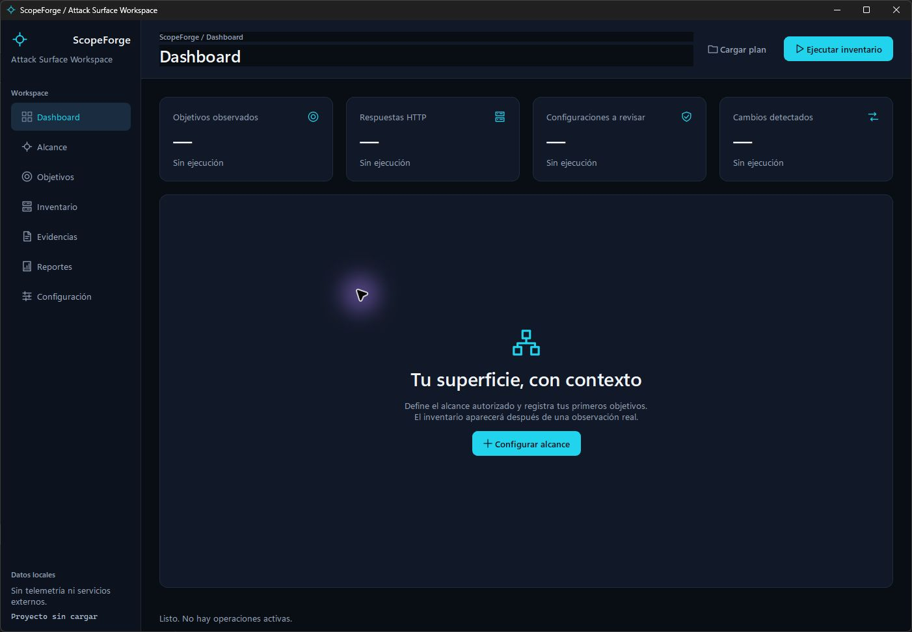

# ScopeForge

Inventario de superficie de ataque con alcance explícito, evidencia HTTP/TLS y seguimiento de cambios.

[](https://github.com/MIGUEL-MOSCOSO-DEV/scopeforge/actions/workflows/ci.yml) · [Descargas](https://github.com/MIGUEL-MOSCOSO-DEV/scopeforge/releases/latest) · [MIT](LICENSE)



## Qué incluye

- Alcance por dominio, IP y CIDR, con exclusiones que tienen prioridad.
- Resolución y validación de cada redirección; conexiones fijadas a las direcciones autorizadas.
- Inventario HTTP/TLS, cabeceras, certificados y diferencias entre ejecuciones.
- Checkpoints, reanudación y exportación JSON/HTML.

No enumera rangos CIDR automáticamente ni utiliza servicios externos de descubrimiento. Una ausencia de cabeceras no demuestra una vulnerabilidad.

## Windows

Descarga **ScopeForge-windows-x64.zip**, extrae todo el contenido y abre **ScopeForge/ScopeForge.exe**. La carpeta `_internal` debe permanecer junto al ejecutable. No requiere Python ni instalación. Compatible con Windows 10/11 de 64 bits.

El ejecutable **scopeforge-cli.exe** permite trabajar desde terminal. Ejecuta `--help` para consultar sus opciones. Los archivos SHA256SUMS permiten verificar las descargas.

La aplicación inicia sin proyectos, objetivos, credenciales ni datos precargados. Los planes e informes se guardan localmente, en las rutas que selecciones.

## Desarrollo

Requiere Python 3.11 o posterior y Go (consulta go.mod). Desde la raíz del repositorio:

```text
python -m venv .venv
.venv\Scripts\python -m pip install -r requirements-dev.txt
go build -o bin/scopeforge-cli.exe ./cmd/scopeforge
.venv\Scripts\python launch.py
```

Para generar la distribución en un entorno virtual limpio:

```text
.venv\Scripts\python tools/build_windows.py
```

El proceso compila la interfaz y el CLI, comprueba las dependencias nativas Qt, crea el ZIP y calcula sus hashes. Excluye la copia de ICU encontrada en PATH para que Qt utilice la API nativa de Windows. No copies DLL de otras instalaciones de Qt a `_internal`.

## Verificación

```text
python -m ruff check .
python -m ruff format --check .
python -m unittest discover -s tests -v
go vet ./...
go test ./...
```

La CI ejecuta las pruebas en Windows y Linux y genera el paquete Windows. Las pruebas usan recursos locales controlados; no auditan sistemas externos. La interfaz utiliza Qt/PySide6 y los motores funcionan de forma independiente.

## Uso responsable

Trabaja únicamente sobre sistemas e identidades para los que tengas autorización explícita. Revisa el alcance y las políticas antes de ejecutar. Conserva los informes como información sensible.

## Licencia

Código MIT. Las bibliotecas Qt se distribuyen de forma dinámica bajo su licencia correspondiente; consulta [THIRD_PARTY_NOTICES.md](THIRD_PARTY_NOTICES.md) y la carpeta [licenses](licenses).
